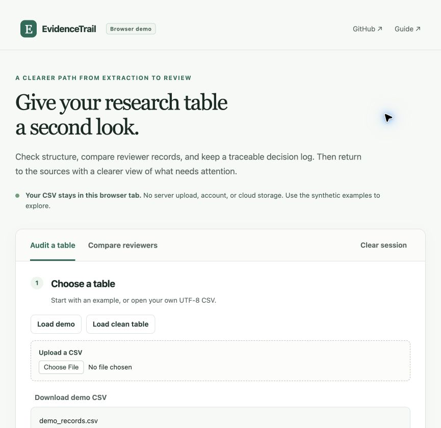

# EvidenceTrail

**A small research tool for checking extraction tables before the next review step.**

An extraction table stores information taken from source reports, one defined item per row. EvidenceTrail helps researchers inspect these tables, compare two reviewers' records, and document the decisions that follow. It finds missing source locations, inconsistent status labels, duplicate record IDs, and recorded disagreements, then turns those checks into downloadable reports.

**New here? [Read the project's background, rationale, and key themes](docs/project-context.md).**

**Learn the concepts:** [Studies, reports, missingness, agreement, and evidence certainty](docs/biology-and-concepts.md).

This is an early working prototype, version **0.3.0**. The included examples contain synthetic records. EvidenceTrail checks table structure and consistency; scientific accuracy still requires reviewing the sources.

**[Try the live browser demo](https://thethunda01.github.io/evidencetrail/)** · No account or installation needed. Start with the synthetic examples, or select a CSV that stays in your browser.



## Why this project

Evidence extraction involves more than copying an answer into a spreadsheet. A useful record also needs a clear connection to a report, an honest account of what the source says, and a way to track review. Small inconsistencies in those records can make later synthesis harder.

EvidenceTrail makes a first pass at those inconsistencies visible. A researcher still decides what needs correction and verifies the evidence against the source.

## What it does

- Reads extraction tables, with explicit mapping from your column names to seven required fields.
- Checks identifiers, status labels, values, and source locations, with explanations and suggested next steps.
- Summarizes recorded review progress and evidence completeness by extraction field.
- Downloads field-level status counts and source-locator coverage with explicit required/provided denominators.
- Compares two reviewer tables by report and field, keeping differences in answers separate from differences in source locations.
- Shows how much of each table could be paired and how often nonblank entries match, with the counts behind each rate.
- Records your choice, name or identifier, and reason for a reviewer decision, while preserving both submitted answers.
- Exports findings and reviewer decision records with input-file fingerprints and other provenance. The Python app also provides a ZIP archive containing audit reports.
- Adds a SHA-256 file manifest (a list of exact-byte fingerprints) to Python audit bundles, with an offline verifier for missing or changed payloads.
- Includes a 20-row demonstration with five planted findings, a clean table, a blank template, and paired reviewer examples.

There are two ways to use EvidenceTrail:

| | Browser demo | Full Python app |
| --- | --- | --- |
| Input | Comma-separated values (CSV) | CSV or an Excel `.xlsx` workbook sheet |
| Checks, column mapping, progress and field summaries | Yes | Yes |
| Reviewer comparison and decision CSV/JSON | Yes | Yes |
| Audit ZIP bundle | No | Yes |
| Processing | In your browser; selected file contents are not uploaded | On the machine running the Python app |
| Setup | Static site, designed for GitHub Pages | Local Python installation |

JSON means JavaScript Object Notation, the structured-text format used for several exports. A mebibyte (MiB) is 1,048,576 bytes. Both versions leave your input files unchanged and use temporary working state. Each file can be up to **5 MiB**, with up to **10,000 data rows** and **50 columns**. In the Python app, Excel workbooks also have a 25 MiB limit on expanded contents, and the selected sheet must contain values rather than formulas.

The [live demo](https://thethunda01.github.io/evidencetrail/) is published from this repository with GitHub Pages. The [hosting guide](docs/deployment.md) explains how it is maintained. See [getting started](docs/getting-started.md) for the differences between versions.

## Quick start

You need Python **3.10 or later** and Git. Open a terminal, then run:

```sh
git clone https://github.com/TheThunda01/evidencetrail.git
cd evidencetrail
python -m venv .venv
```

If your system uses the command `python3`, use `python3 -m venv .venv` for that last step.

Activate the environment on macOS or Linux:

```sh
source .venv/bin/activate
```

Or in Windows PowerShell:

```powershell
.venv\Scripts\Activate.ps1
```

Then install the dependencies and start the app:

```sh
python -m pip install -r requirements.txt
python -m streamlit run app.py
```

Open the local address printed in the terminal. The [getting-started guide](docs/getting-started.md) walks through the demo and your first audit.

The **Audit a table** workspace opens with **Demo with five issues** selected. Review the findings, compare the **Clean example**, or choose **Upload a file** to check your own table. The [demo's expected-findings file](examples/expected_findings.json) records the deliberately planted issues.

To make and check a synthetic audit bundle from the command line:

```sh
python scripts/bundle_example.py /tmp/evidencetrail-demo.zip
python -m evidencetrail.verify_bundle /tmp/evidencetrail-demo.zip
```

Choose a new output path: the example builder refuses to overwrite a file. The verifier checks five payload files against an unsigned manifest; it does not authenticate the reviewer or the evidence.

To compare a bundle with a separately obtained expected ZIP fingerprint, add `--expected-sha256`. This command illustrates the option using the pinned synthetic example:

```sh
python -m evidencetrail.verify_bundle examples/audit_bundle_v1.zip --expected-sha256 9475c42008d56afae7cd7f869620bc6faf62822c07c2f1b95958ebfbd036a820
```

For an actual handoff, obtain the expected digest through an independently trusted record. Copying it from the same received ZIP or replacing both together defeats that comparison. A matching reference is not a signature or a scientific check.

## Example results

The synthetic audit contains 20 rows and five deliberately planted findings. The reviewer example yields 19 comparable pairs, 17 exact agreements and two differences. These are software fixtures, not research results. The bundle verifier reports five checked payloads and `consistent: true` for an unmodified new bundle; changing a payload without updating its manifest produces a mismatch.

## Practical use and limitations

### Table format

Use **one row per extracted field**. Each row has its own `record_id`; several rows can share a `report_id` when they describe the same report.

| Required column | Purpose |
| --- | --- |
| `record_id` | A unique identifier for this extraction row. |
| `report_id` | The identifier of the report being described. |
| `field` | The question or attribute being extracted. |
| `value` | The extracted answer, when available. |
| `evidence_status` | Whether and how the source supports an answer. |
| `source_locator` | A page, section, table, figure, or other location in the source. |
| `review_status` | The current review state of the row. |

Your source columns can have different names: map each one to its role in the app. Mapping changes column names in a working copy, not cell values or status labels. Optional columns include `reviewer`, `notes`, and `source_url`. Start with [the blank CSV template](examples/extraction_template.csv), and see the [data dictionary](docs/data-dictionary.md) for allowed labels and examples.

For reviewer comparison, each combination of `report_id` and `field` must occur once in each table. The reviewers' `record_id` values can differ. Missing or ambiguous comparison keys are blocked rather than paired automatically.

### What a finding means

A finding is a reason to inspect a record. For example, a row marked `Reported` with no source location needs a source check. A duplicated `record_id` needs a decision about the identifiers or the rows. A `Disagreement` needs researcher review.

Findings distinguish required table corrections from missing supporting information and disagreements. Downloads label these categories `error` and `review`; neither label is a judgment of scientific accuracy. The browser shows explanations and next steps in its findings table. In the Python app, choose **Inspect a finding** for those details.

**Zero findings means only that these checks found no issues.** A table can pass every check and still contain an incorrect extraction, an incomplete source location, or a mistaken interpretation. Likewise, `Verified` is a status supplied by the researcher, not a certification from the app.

The [methods and limitations](docs/methods-and-limitations.md) explain exactly what the checks cover.

### Compare reviewers and record decisions

Choose **Compare reviewers** and load the reviewer demo: **Load reviewer demo** in each browser panel, or **Demo reviewers** in the Python app. The underlying [reviewer_a.csv](examples/reviewer_a.csv) and [reviewer_b.csv](examples/reviewer_b.csv) contain 19 comparable pairs: 17 agree on answer and evidence status, and two differ. Each table also has one unmatched record. Two matched pairs use different source locations.

The comparison summaries keep two questions separate. **Pairing coverage** is the number of comparable pairs divided by all submitted rows on that side, including rows excluded because their keys are missing or duplicated. For the demo, that is 19 of 20 rows, or 95%, for each reviewer. **Nonblank agreement** compares each column separately: `value` and `evidence_status`. Its denominator includes only matched pairs with text on both sides; one-sided blanks and joint blanks are counted separately. An empty denominator produces an undefined rate, not zero.

The original exact-match count still includes pairs whose compared entries match even when some entries are blank. A blank answer can be appropriate for `Not reported` or `Not applicable`, so blankness alone is not an extraction error. These summaries describe the submitted text, not extraction accuracy, reviewer reliability, or readiness for synthesis. See the [metric definitions](docs/methods-and-limitations.md#comparison-metrics) before interpreting a percentage.

For a matched pair, you can use either reviewer's answer, enter a different answer, or defer the decision. Each saved decision needs a reviewer name or identifier and a reason. Saving again for the same pair replaces its current decision in the session. Download a copy before clearing the session or leaving the app; it is not a persistent research database or an append-only history.

Decisions do not alter the source tables or automatically mark their rows as `Verified`. A recorded decision is your documented choice, not source verification performed by the app.

### Data handling

Both versions keep working data and current reviewer decisions in memory. They do not fetch source links or send records to an external analysis service. Downloaded files are saved wherever you choose in your browser.

The Python app's audit ZIP excludes the original upload and extracted answer values, but includes record IDs, field labels, source filenames, mappings, and other audit metadata. The browser audit JSON also contains identifiers and field summaries. Reviewer comparison and decision downloads include the submitted answers and locators. Inspect exports before sharing them.

In the **browser demo**, selected CSV contents and decisions stay in browser memory. The demo does not transmit them, use a backend database, save them to browser storage, or load code from a third-party content delivery network (CDN). GitHub still receives normal requests for the page and its assets; its hosting documentation describes [visitor Internet Protocol (IP) address logging](https://docs.github.com/en/pages/getting-started-with-github-pages/what-is-github-pages#data-collection).

In the **Python app**, processing occurs on the machine running it. A local session uses your computer; a separately hosted instance sends uploaded files to that host, where administrators and infrastructure may have access to runtime data. The repository examples are synthetic; do not add participant data or confidential research records to the public repository. Neither version is a persistent research repository.

The optional whole-ZIP check reports `external_reference.matches` separately from the existing `consistent` payload result. With the option supplied, either mismatch makes the CLI exit with status 1. Without it, the previous receipt format and behavior are preserved. See [the round-2 review update](docs/literature-review.md#question-and-scope) for the reasoning.

## Documentation

| Page | Purpose |
| --- | --- |
| [Glossary](docs/glossary.md) | Definitions of scientific, statistical, and software terms |
| [Assumptions](docs/assumptions.md) | Rationale, checks, and consequences of each material assumption |
| [Reference list](docs/references.md) | Complete citations and the role of each source |
| [Reference audit](docs/reference-audit.json) | Source checks, access levels, and remaining limitations |
| [Editorial review](docs/review-2026-10-20.md) | Corrections and checks completed on October 20, 2026 |
| [Project context](docs/project-context.md) | Background, rationale, and key themes |
| [Biology and concepts](docs/biology-and-concepts.md) | Studies, reports, missingness, agreement, and certainty |
| [Methods and limitations](docs/methods-and-limitations.md) | Exact checks, denominators, and boundaries |
| [Data provenance](docs/data-provenance.md) | Synthetic examples and user-supplied records |
| [Practical use](docs/practical-use.md) | Input/output contract and worked handoff |
| [Sources and earlier review](docs/research-review-2026-10-13.md) | Prior evidence and related tools |
| [Rapid literature review](docs/literature-review.md) | Search record, source appraisal, and implementation decisions |
| [Getting started](docs/getting-started.md) / [Data dictionary](docs/data-dictionary.md) | App walkthrough and allowed values |

## Development and reuse

### Check the code

Run the Python checks from the project directory:

```sh
python -m unittest discover -s tests -v
```

For the browser core, use Node.js 22 or later:

```sh
node --test tests/web-core.test.mjs
```

The browser parity tests compare known examples with the Python implementation. They check software behavior, not effectiveness in real reviews. For ways to help, see [CONTRIBUTING.md](CONTRIBUTING.md).

### Research basis and next steps

The [research review](docs/research-review-2026-10-13.md) explains the scientific and practical guidance behind the expansion, including where established tools already address these needs. This is an evidence-informed design, not a validated intervention.

Future work could add configurable validation schemas, additional table structures, and carefully evaluated Portable Document Format (PDF) or artificial intelligence (AI) assistance. A user pilot should assess mapping usability and how people find and resolve known issues before claims are made about research benefits.

See [CHANGELOG.md](CHANGELOG.md) for the version history.

### Reuse and citation

The code is available under the [MIT license](LICENSE). If you use EvidenceTrail in research, the repository includes [citation metadata](CITATION.cff). Record the version you used so others can identify the same implementation.

The current [rapid review](docs/literature-review.md) documents why the new bundle check focuses on an inspectable handoff, without claiming reduced error rates.
