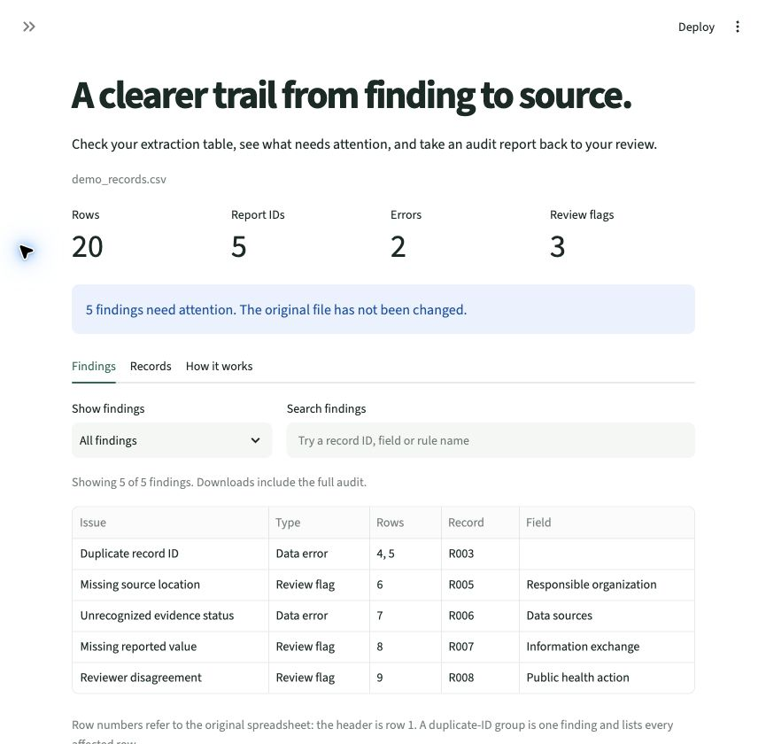

# EvidenceTrail

**A small research tool for checking extraction tables before the next review step.**

EvidenceTrail helps researchers find missing source locations, inconsistent status labels, duplicate record IDs, and unresolved disagreements in a structured extraction table. It turns those checks into a report that can be reviewed alongside the original sources.

This is an early working prototype, version **0.1.0**. The included examples contain synthetic records. EvidenceTrail checks the structure and consistency of a table; it does not establish that a finding is scientifically correct.



## Why this project exists

Evidence extraction involves more than copying an answer into a spreadsheet. A useful record also needs a clear connection to a report, an honest account of what the source says, and a way to track review. Small inconsistencies in those records can make later synthesis harder.

EvidenceTrail makes a first pass at those inconsistencies visible. A researcher still decides what needs correction and verifies the evidence against the source.

## What the prototype does

- Reads a CSV file or a selected sheet in an Excel `.xlsx` workbook.
- Checks required headers, identifiers, status labels, values, and source locations.
- Flags records marked as a reviewer disagreement.
- Shows findings with the affected rows and a suggested next step.
- Exports an audit report with a SHA-256 fingerprint of the input file.
- Includes a 20-row demonstration with five deliberately planted findings, a clean example, and a blank template.

The app accepts files up to **5 MiB**, with up to **10,000 data rows** and **50 columns**. Excel workbooks also have a 25 MiB limit on their expanded contents. The selected sheet must contain values rather than formulas. The app does not change the input file or automatically correct records.

## Run it locally

You need Python **3.10 or later** and Git. Open a terminal, then run:

```sh
git clone https://github.com/TheThunda01/evidencetrail.git
cd evidencetrail
python -m venv .venv
```

If your system uses the command `python3`, use `python3 -m venv .venv` for that last step.

Activate the environment on macOS or Linux:

```sh
source .venv/bin/activate
```

Or in Windows PowerShell:

```powershell
.venv\Scripts\Activate.ps1
```

Then install the dependencies and start the app:

```sh
python -m pip install -r requirements.txt
python -m streamlit run app.py
```

Open the local address printed in the terminal. The [getting-started guide](docs/getting-started.md) walks through the demo and your first audit.

The app opens with **Demo with five issues** selected. Review the findings, compare the **Clean example**, or choose **Upload a file** to check your own table. The [demo's expected-findings file](examples/expected_findings.json) records the deliberately planted issues.

## Table format

Use **one row per extracted field**. Each row has its own `record_id`; several rows can share a `report_id` when they describe the same report.

| Required column | Purpose |
| --- | --- |
| `record_id` | A unique identifier for this extraction row. |
| `report_id` | The identifier of the report being described. |
| `field` | The question or attribute being extracted. |
| `value` | The extracted answer, when available. |
| `evidence_status` | Whether and how the source supports an answer. |
| `source_locator` | A page, section, table, figure, or other location in the source. |
| `review_status` | The current review state of the row. |

Optional columns are `reviewer`, `notes`, and `source_url`. Start with [the blank CSV template](examples/extraction_template.csv), and see the [data dictionary](docs/data-dictionary.md) for the allowed labels and examples.

## What a finding means

A finding is a reason to inspect a record. For example, a row marked `Reported` with no source location needs a source check. A duplicated `record_id` needs a decision about the identifiers or the rows. A `Disagreement` needs researcher review.

The app labels these as **Data errors** for required identifiers, fields, and status labels, or **Review flags** for missing supporting information and disagreements. Downloads use `error` and `review` for these same categories. Neither label is a judgment of scientific accuracy. Choose **Inspect a finding** to read the explanation and suggested next step.

**Zero findings means only that these checks found no issues.** A table can pass every check and still contain an incorrect extraction, an incomplete source location, or a mistaken interpretation. Likewise, `Verified` is a status supplied by the researcher, not a certification from the app.

The [methods and limitations](docs/methods-and-limitations.md) explain exactly what the checks cover.

## Data handling

Uploaded data is processed in memory by the running app. The application does not intentionally save uploads to disk, cache extraction tables, fetch source links, or send records to an external analysis service. Downloaded reports are saved wherever you choose in your browser.

When you run the app locally, processing occurs on your computer. If you host it elsewhere, processing occurs on that host, where administrators and infrastructure may have access to runtime data. Review the hosting environment before using confidential or restricted material. The repository examples are synthetic; do not add real participant data or confidential research records to a public repository.

This repository provides the app's source code and local setup instructions. It does not imply that a public hosted service is available.

## Check the code

Run the automated checks from the project directory:

```sh
python -m unittest discover -s tests -v
```

The project separates the audit rules from the interface so the rules can be checked with small, known examples. For ways to help, see [CONTRIBUTING.md](CONTRIBUTING.md).

## Possible next steps

Future work could add side-by-side reviewer comparison, a documented correction history, and more flexible field definitions. These are ideas for later versions, not features of the current prototype. Source verification and adjudication remain research decisions.

See [CHANGELOG.md](CHANGELOG.md) for the version history.

## Reuse and citation

The code is available under the [MIT license](LICENSE). If you use EvidenceTrail in research, the repository includes [citation metadata](CITATION.cff). Record the version you used so others can identify the same implementation.
