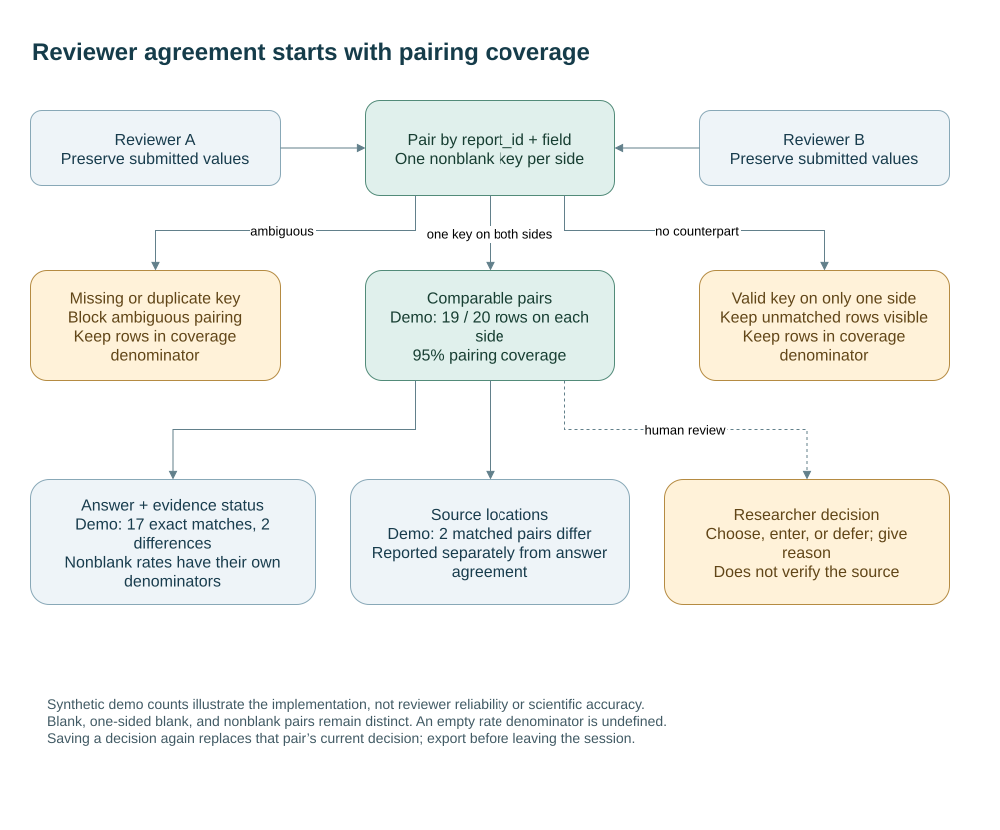

# Follow the comparison denominators

The diagram separates three questions: which submitted rows can be paired, how the paired text compares, and what a researcher decides after reviewing a difference. Those questions have different denominators and evidence requirements.



The counts come from the committed synthetic [reviewer A](../examples/reviewer_a.csv) and [reviewer B](../examples/reviewer_b.csv) fixtures. Each side supplies 20 rows; 19 pair by `report_id` and `field`. Seventeen pairs agree on the compared answer and status, two differ, and two matched pairs have differing source locations. The answer and locator counts are separate; they need not identify the same pairs.

Missing or duplicate comparison keys block pairing. Those submitted rows still belong in that side's pairing-coverage denominator. Nonblank agreement then has its own denominator among matched pairs, with one-sided and joint blanks counted separately. See the [exact implementation definitions](methods-and-limitations.md#comparison-metrics). Matching text does not establish source support, and a saved decision does not automatically verify an extraction.

## Edit and reproduce

Open [reviewer-comparison.drawio](diagrams/reviewer-comparison.drawio) in draw.io Desktop. SVG and PNG are committed previews; the editable source is retained. Regenerate both exports from the repository root:

```sh
python scripts/export_workflow.py --drawio /path/to/draw.io
```

On Windows, supply the full path to `draw.io.exe` in quotes. The export script replaces only the two diagram previews. The recorded rendering tool is draw.io Desktop 32.6.1. Keep the counts synchronized with the synthetic fixtures and the comparison tests if those fixtures change. The diagram is an explanation of the implementation, not a newly measured reliability result.
